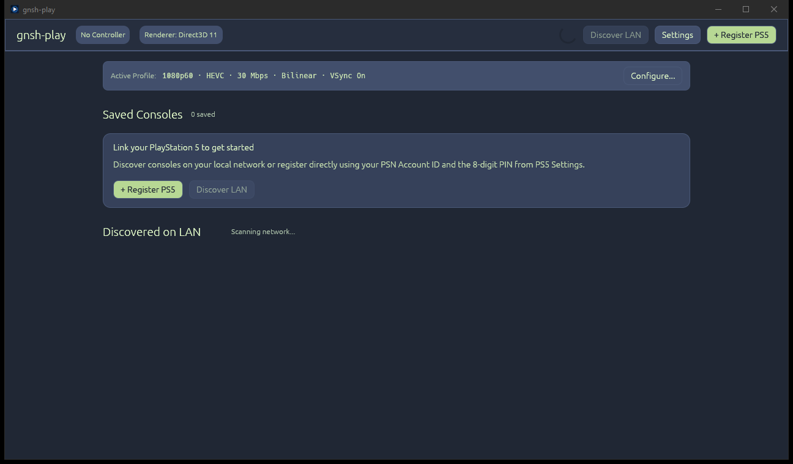

# gnsh-play

Native Windows x64 PlayStation 5 Remote Play client built in Rust (`AGPL-3.0-only`), powered by `streetpea/chiaki-ng` (`libchiaki`), FFmpeg (`D3D11VA` / `D3D12VA` / `Vulkan Video` + software fallback), native Direct3D 11 / Direct3D 12, Vulkan (`libplacebo`), SDL3, and `egui`.



## Quick Start (Portable Windows Binary)

1. Download **`gnsh-play-v0.2.0-win64.zip`** (and optionally `.sha256`) from [GitHub Releases](https://github.com/Gnesh97/gnsh-play/releases).
2. *(Optional)* Verify the archive checksum in PowerShell:
   ```powershell
   Get-FileHash .\gnsh-play-v0.2.0-win64.zip -Algorithm SHA256
   ```
3. Extract the folder and launch **`gnsh-play.exe`** (no MSYS2 or Rust installation needed).
   > **Note:** Binaries are currently unsigned, so Windows SmartScreen may show an *"Unknown publisher"* prompt on first launch (`More info` -> `Run anyway`).
4. Link your PS5 in under 2 minutes:
   - Click **Discover LAN** (or **+ Register PS5** if connecting across subnets/VPN).
   - Sign in with your **PSN Account ID** using the built-in browser OAuth helper (or paste Base64 ID directly).
   - Enter the 8-digit PIN from **PS5 Settings -> System -> Remote Play -> Link Device**, then click **Connect**.

## Why gnsh-play?

| Capability | `gnsh-play` (`v0.2.0`) | `chiaki-ng` | Official PS Remote Play |
| :--- | :--- | :--- | :--- |
| **Supported Platforms** | Windows x64 only | Windows, Linux, macOS, Steam Deck, handhelds | Windows, macOS, iOS, Android |
| **Consoles** | PS5 only | PS4 & PS5 | PS4 & PS5 |
| **GPU Renderers** | Direct3D 11, Direct3D 12 (`D3D12VA`), Vulkan (`libplacebo`) | OpenGL / Vulkan (`libplacebo`) / D3D11 | Direct3D (closed source) |
| **Post-Processing & Diagnostics** | CAS, AMD FSR 1.0, GPU Deband, live Vibrance/Contrast/Gamma/HDR->SDR Exposure, `{w}x{h}` resize warning & `Pipe` ms HUD | `libplacebo` shaders & basic stats | None |
| **USB DualSense Haptics & Triggers** | 4ch USB audio haptics + DS5 triggers + mute LED | Yes (cross-platform) | Yes |
| **KB+M Emulation & Capture** | Built-in virtual DualSense + remapper, zero-reencode `.mkv` record & Replay Buffer, HDR->SDR PNG screenshots | Configurable KBM; no built-in replay buffer | None |
| **WAN Discovery** | Direct IP/DDNS/VPN host + port forwarding | PSN cloud push + direct IP | Automatic Sony cloud relay |
| **Maturity** | Early release (`v0.2.0`) | Established, multi-year community project | Official first-party app |

### Known Limitations

- **Windows x64 & PS5 only:** There are no Linux, macOS, or PS4 builds at this stage.
- **Direct WAN requires port forwarding or VPN:** There is no Sony PSN Push cloud auto-discovery relay; remote play uses a saved static IP, DDNS hostname, or Tailscale/WireGuard tunnel.
- **Vulkan headless GPU test caveat:** On AMD Windows Adrenalin drivers, the automated headless Vulkan Video zero-copy readback test currently hits a driver-specific black-readback quirk while live D3D11, D3D12, and Vulkan (`libplacebo`) UI/video paths run normally.

## Features (LAN & Direct WAN/VPN, PS5 Only)

- **LAN Broadcast + Remote / WAN / VPN Discovery & Wake-Up**: DDP subnet broadcast + unicast remote host probing (`discover_ps5_hosts` via `libchiaki` in `gnsh-proto`), configurable LAN + optional `Remote / WAN / VPN Host` per saved console (`Edit`, `Connect WAN`, dual LAN/WAN `Wake`), `normalize_console_host` (`:port` & `http(s)://` stripping), and `4 MiB` runtime `SO_RCVBUF` socket tuning (`UDP_RECV_BUF_BYTES`).
- **Auto-Reconnect & Separate LAN/WAN Profiles**: Configurable transient disconnect recovery (`2s / 4s / 8s` backoff with automatic **LAN -> WAN fallback** when a remote host is saved and non-retryable error filtering for PIN/in-use/standby/decoder failures), plus an optional independent **WAN Profile** (`wan_preset`, `wan_codec`, `wan_bitrate_kbps`) for lower-bandwidth remote links.
- **Direct-Stream CLI & Desktop Shortcuts**: Launch directly into fullscreen streaming via `--connect <NAME|ID|HOST>` (`--wan`, `--fullscreen`), inspect saved consoles with `--list`, or export native Win32 COM Windows Desktop `.lnk` shortcuts (`Shortcut` and `Shortcut (WAN)`).
- **PSN Account ID & 8-Digit PIN Linking**: Browser OAuth redirect URL helper (or direct Base64 Account ID) + PS5 registration flow persisted in Windows DPAPI encrypted storage (`%APPDATA%\gnsh-play\consoles.json`).
- **Low-Latency Media Pipeline, Multi-Backend Graphics & Upscaling**: FFmpeg `D3D11VA` / `D3D12VA` / **Vulkan Video (`VK_KHR_video_decode_h264`/`h265`)** zero-copy hardware decode (`thread_count = 1`, `thread_type = 2` slice-only, `AV_CODEC_FLAG_LOW_DELAY | AV_CODEC_FLAG2_FAST`) with automatic `D3D11Transfer` & software fallback (`NV12` / `P010` / `YUV420P`), `AVFrame` color matrix & quantization range propagation (`BT.601`/`BT.709`/`BT.2020`, `Limited`/`Full`) with MPEG left-sited (`LEFT`) `4:2:0` chroma alignment, backend-agnostic `VideoRenderer` + `UiOverlayRenderer` traits with selectable **`Settings -> Video -> Renderer`** (`Auto | Direct3D 11 | Vulkan | D3D12`, restart-applied with automatic fallback to Direct3D 11): native DXGI flip-model **Direct3D 11** & **Direct3D 12** (`Fit`/`Zoom`/`Stretch`, 1-frame waitable swapchain, `IDXGIOutput6` Windows HDR10 passthrough or BT.2020->ACES tone-mapping, `Bilinear`, single-pass HLSL **CAS**, 2-pass **AMD FSR 1.0**, plus DX12 fence-synced `D3D12VA` zero-copy and shared `egui` overlay pass) and opt-in **Vulkan (`libplacebo`)** (`pl_render_fast_params` with `Bilinear` / `Spline36`, dynamic `PRE_OUTPUT` CAS + grading shader, HDR10 colorspace hint, and GLSL 450 `egui` overlay pass), single-pass GPU **Deband** plus live **Vibrance / Contrast / Gamma / HDR->SDR Exposure** controls (`Settings -> Video`, live HUD Quick Settings, `Reset Image`), decode-paced `Condvar` frame wakeup + 1000 Hz controller polling when `VSync` is off, zero-`egui` pass when HUD is hidden (`F3`), `chiaki_opus_decoder` + SDL3 30 ms capped stereo playback with selectable audio & microphone devices + live `0..=100%` gain, **4-channel USB DualSense audio haptics** (with automatic motor-rumble fallback), and **Opus microphone uplink** (`gnsh-media`, `gnsh-proto`).
- **Zero-Overhead Capture, Raw-Remux Recording & Replay Buffer**: Lossless PNG screenshots (`F12`, automatic BT.2020 PQ->ACES HDR->SDR tone-mapping for P010 HDR10), raw-remux `.mkv` recording (`F9`, copies H.264/HEVC Annex-B video + stereo `pcm_s16le` audio directly with zero re-encoding), and an optional rolling memory **Replay Buffer** (`F10` Save Clip, `15s` / `30s` / `60s`, `512 MiB` cap) with zero packet-cloning overhead when disabled, configurable capture directory (`Settings -> Video -> Capture Folder`), `REC MM:SS` corner badge, and non-blocking top-right status toasts.
- **Native Input, Full Gamepad UI Navigation & KB+M Emulation**: SDL3 windowing + Win32 `HWND` hosting with embedded multi-resolution app icon & version resource, `egui` 0.37 tabbed UI (`Video` / `Audio` / `Input` Settings + collapsible Streaming HUD drawer), native auto-focused UTF-8 **PS5 On-Screen Keyboard (`OSK`) modal**, `Home` / `PS Home` button, full **DualSense UI control** across Home (`D-Pad` / Stick, `Cross` Connect, `Triangle` Wake, `Square` Discover, `Options` Settings, `Circle` Back), Settings (`L1`/`R1` tabs, `Left`/`Right` sliders/selectors), and Streaming HUD (`L1+R1+Options` chord with automatic neutral controller reset), virtual **Keyboard & Mouse emulation** (`WASD` normalized stick, progressive `8 ms` mouse-to-right-stick with `Sens`, `DZ`, `Curve` `50..=150%`, active-only flick carryover, and `Invert Y`, `F8` capture, conflict-free `Keybinds...` remapping), DualSense adaptive triggers & orange mic LED, click-only default + capacitive toggle touchpad (`Touchpad Touch`), gyro/accel sensors, lightbar LED, and automatic Win32 sleep inhibitor (`SetThreadExecutionState` + `timeBeginPeriod`).
- **Persistent Settings, Telemetry & File Logging**: Saves preferences to `%APPDATA%\gnsh-play\settings.json`, renders live HUD telemetry (decoded `{w}x{h}` resolution with amber `Res ...!` adaptive-resize warning, `FPS`, rolling `Mbps`, live Win32 ICMP `RTT`, 200 ms x 10 `Loss %`, per-frame PTS `Pipe` p50/p95 ms + `Buf` lag, `HDR10`/`HDR->SDR`, `CAS`/`FSR 1.0`, `Deband`, `Frame:`/`Image:` hover diagnostics, `UDP Buf KiB`), and writes non-blocking logs + panic traces to `%APPDATA%\gnsh-play\gnsh-play.log`.
- **Console-less Portable Distribution**: Release builds use `windows_subsystem = "windows"` while restoring CLI stdout via `AttachConsole` (`--help`, `--discover`, `--list`), staged with MinGW64 runtime DLLs and optional `.zip` + `.sha256` archive generation via `scripts/stage-dist.ps1`.

## Workspace Architecture

| Crate / Path | Role |
| :--- | :--- |
| [`crates/gnsh-chiaki-sys`](crates/gnsh-chiaki-sys) | Raw bindgen FFI bindings to static `third_party/chiaki-ng` (`libchiaki.a`) |
| [`crates/gnsh-proto`](crates/gnsh-proto) | Safe Rust wrapper for LAN/unicast discovery, wake-up, host validation/normalization, PSN OAuth exchange, PIN registration, controller state, and `Ps5Session` |
| [`crates/gnsh-media`](crates/gnsh-media) | FFmpeg `D3D11VA` / `D3D12VA` / SW `VideoDecoder`, `VideoRenderer` + `UiOverlayRenderer` traits (`RendererBackend`), DXGI/HLSL `D3D11Renderer` & `D3D12Renderer` (`CAS` + `FSR 1.0`), `VulkanPlaceboRenderer` (`libplacebo`), and SDL3 `AudioOutput` / `HapticsAudioOutput` / `MicCapture` |
| [`crates/gnsh-input`](crates/gnsh-input) | SDL3 windowing (HWND for Direct3D 11/12 & Vulkan surfaces), Win32 `HWND`/clipboard integration, `egui` event translation, `GamepadManager`, and `KbmEmulator` |
| [`crates/gnsh-app`](crates/gnsh-app) | `gnsh-play` CLI/GUI application (`main.rs`), Win32 icon/version resources (`build.rs`, `assets/`), modular `egui` UI ([`ui/`](crates/gnsh-app/src/ui/mod.rs)), desktop `.lnk` creator (`shortcut.rs`), gamepad UI navigation (`gamepad_nav.rs`), auto-reconnect (`reconnect.rs`), stream/media workers (`stream.rs`), `egui` D3D11 & shared `UiOverlayRenderer` (`Vulkan` / `D3D12`) painters (`egui_d3d11.rs`, `egui_placebo.rs`), logging (`logging.rs`), and DPAPI storage (`storage.rs`) |
| [`scripts/stage-dist.ps1`](scripts/stage-dist.ps1) | Release build, standalone `dist/` DLL staging, and optional `-Zip` + `.sha256` portable packager |

## Prerequisites (Windows x64)

- **Rustup** (`stable-x86_64-pc-windows-gnu`)
- **MSYS2 MINGW64** (`C:\msys64\mingw64`) with GCC, `windres`, CMake, Ninja, Clang (`LIBCLANG_PATH`), OpenSSL, Opus, json-c, miniupnpc, libevent, curl, FFmpeg, SDL3, `vulkan-headers`, `vulkan-loader` (`vulkan-1`), and `libplacebo` (`libplacebo-387`)
- Initialized git submodule `third_party/chiaki-ng` built into `third_party/build/chiaki-ng/`

## Build, Test & Package

```powershell
$env:PATH = "C:\msys64\mingw64\bin;C:\msys64\usr\bin;$env:USERPROFILE\.cargo\bin;$env:PATH"
$env:LIBCLANG_PATH = "C:\msys64\mingw64\bin"

cargo fmt --all -- --check
cargo clippy --workspace --all-targets -- -D warnings
cargo test --workspace

# Stage standalone release bundle into dist\
powershell -ExecutionPolicy Bypass -File .\scripts\stage-dist.ps1

# Stage + create portable zip & .sha256 in dist-packages\
powershell -ExecutionPolicy Bypass -File .\scripts\stage-dist.ps1 -Zip
```

## Running `gnsh-play`

```powershell
# Print CLI usage
.\dist\gnsh-play.exe --help

# Scan local LAN subnets for PS5 consoles and exit
.\dist\gnsh-play.exe --discover

# List saved PS5 consoles and exit
.\dist\gnsh-play.exe --list

# Directly connect to a saved console by name, ID, or host in fullscreen
.\dist\gnsh-play.exe --connect "PS5-LivingRoom" --fullscreen

# Directly connect via saved Remote / WAN / VPN host
.\dist\gnsh-play.exe --connect 001122334455 --wan --fullscreen

# Launch GUI
.\dist\gnsh-play.exe
```

### Shortcuts & Controls

- **`F3`**: Toggle the streaming HUD overlay and Quick Settings drawer
- **`F8`**: Toggle cursor capture (`KB+M` virtual DualSense mode; auto-enables `KB+M` when pressed while streaming)
- **`F9`**: Start / stop raw-remux `.mkv` recording
- **`F10`**: Save buffered **Replay Buffer** clip to `.mkv` (when enabled in `Settings -> Video`)
- **`F11`**: Toggle fullscreen mode
- **`F12`**: Save lossless PNG screenshot of the active stream frame (`%USERPROFILE%\Pictures\gnsh-play\`)
- **`Home`**: Send the PlayStation Home button (`PS Home`) when no text modal is open
- **`Ctrl+M` / DualSense Mute Button**: Toggle uplink microphone mute state (syncs controller orange mic LED)
- **`Escape`**: Unlock mouse cursor if locked, cancel open OSK/modal/Quick Settings drawer, or disconnect active stream
- **DualSense / Gamepad UI**:
  - **Home**: `D-Pad` / Stick select console card, `Cross` Connect, `Triangle` Wake, `Square` Discover LAN, `Options` Open Settings, `Circle` Close modal / Cancel reconnect
  - **Settings**: `D-Pad Up/Down` choose row, `Left/Right` adjust, `L1`/`R1` switch tab, `Cross` toggle/cycle, `Circle` Close
  - **Streaming HUD**: Press **`L1 + R1 + Options`** simultaneously to toggle Quick Settings drawer without touching mouse/keyboard (forwards neutral controller input to PS5 while menu is open)

## License, Security & Attribution

- `gnsh-play` is licensed under [`AGPL-3.0-only`](LICENSE) (with the OpenSSL Section 7 linking exception) because it statically links `streetpea/chiaki-ng` (`third_party/chiaki-ng`, AGPL-3.0). See [`THIRD_PARTY_LICENSES.md`](THIRD_PARTY_LICENSES.md) for bundled MSYS2/MinGW64 DLLs and Rust crate attributions.
- Vulnerability disclosures: see [`SECURITY.md`](SECURITY.md).
- Contributions: see [`CONTRIBUTING.md`](CONTRIBUTING.md).

## Documentation

- [Design System Specification](DESIGN.md) — Slate-navy surface ladder (`#202734` / `#36415A`), sage-lime accent (`#B7D894` / `#E0F8C7`), WCAG contrast tokens, layout hierarchy, and HUD/modal rules.
- [Architecture Overview](docs/architecture.md) — Workspace crate boundaries, low-latency media/input threading, Direct3D 11 / Direct3D 12 / Vulkan pipelines, and security model.
- [v0.2.0 Deploy & Release Checklist](docs/release-checklist-v0.2.0.md) — Pre-release gates, hardware smoke tests, packaging, and rollback criteria.
- [Changelog](CHANGELOG.md) — Atomic change log updated on every commit.
