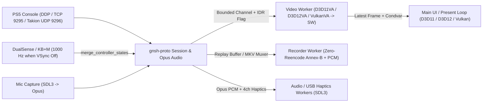

# `gnsh-play` Architecture Overview

`gnsh-play` is a native Windows x64 PlayStation 5 Remote Play client written in Rust (`AGPL-3.0-only`). It pairs a lightweight `egui` + SDL3 interface with zero-copy hardware video decoding, multi-backend GPU presentation (`Direct3D 11`, `Direct3D 12`, and `Vulkan` via `libplacebo`), low-latency DualSense haptics/triggers, and raw-remux capture.

## Workspace Crates

| Crate | Responsibility |
| :--- | :--- |
| [`crates/gnsh-chiaki-sys`](../crates/gnsh-chiaki-sys) | `bindgen` FFI bindings to static `third_party/chiaki-ng` (`libchiaki.a`) |
| [`crates/gnsh-proto`](../crates/gnsh-proto) | Safe Rust wrapper for DDP LAN/unicast discovery, Wake-on-LAN/PSN wake-up, host normalization & validation, PSN OAuth exchange, 8-digit PIN registration, `Ps5Session` control, and Win32 ICMP RTT probing |
| [`crates/gnsh-media`](../crates/gnsh-media) | FFmpeg (`D3D11VA` / `D3D12VA` / `Vulkan Video` + software fallback) decoder, `FrameColorInfo` metadata, `VideoRenderer` + `UiOverlayRenderer` traits, HLSL `D3D11Renderer` / `D3D12Renderer` (`Bilinear`, `CAS`, `FSR 1.0`, `Deband`, live image grading), `VulkanPlaceboRenderer` (`libplacebo`), SDL3 audio/haptics/mic streams, lossless PNG screenshots, and `.mkv` raw-remux recording + replay ring buffer |
| [`crates/gnsh-input`](../crates/gnsh-input) | SDL3 windowing (`HWND` & `VkSurfaceKHR`), clipboard & DPI helpers, `egui` input translation, DualSense gamepad state/LED/trigger/rumble HID packets, and `KbmEmulator` virtual controller mapping |
| [`crates/gnsh-app`](../crates/gnsh-app) | CLI/GUI entrypoint (`main.rs`), Win32 icon/version resources, DPAPI encrypted console store & JSON settings (`storage.rs`), media worker orchestration (`stream.rs`), `egui` render bridges (`egui_d3d11.rs`, `egui_placebo.rs`), auto-reconnect (`reconnect.rs`), desktop `.lnk` shortcuts (`shortcut.rs`), gamepad UI navigation (`gamepad_nav.rs`), non-blocking log writer (`logging.rs`), and modular UI views (`ui/`) |

## Threading & Low-Latency Pipeline

- **Non-Blocking Receive Path:** Logging writes offload to a background channel (`gnsh-log-writer`) so disk I/O never stalls `libchiaki`'s UDP receive thread or overflows crypto keystream buffers.
- **Zero-Copy Decode Chains:**
  - `Direct3D 11`: `D3D11VA` `Texture2DArray` slice -> direct HLSL `NV12`/`P010` SRV sampling -> 1-frame DXGI waitable flip swapchain.
  - `Direct3D 12`: `D3D12VA` fence-synced textures (or automatic `D3D11Transfer` semi-planar fallback) -> root-signature HLSL pipeline (`CAS` / 2-pass `FSR 1.0`) -> 2-frame waitable swapchain.
  - `Vulkan`: Shared `VkDevice` + `VK_KHR_video_decode_h264`/`h265` zero-copy `AVVkFrame` interop (or `D3D11Transfer` fallback) -> `libplacebo` (`Spline36` + optional 1-pass deband + `PRE_OUTPUT` CAS/grade hook) + GLSL `egui` pass.
- **Color & Image Quality:** FFmpeg `AVFrame` matrix (`BT.601`/`BT.709`/`BT.2020`) and quantization range (`Limited`/`Full`) flow through `FrameColorInfo` into every renderer and screenshot converter; D3D11/D3D12 apply left-sited `4:2:0` MPEG chroma phase alignment; `VideoImageAdjustments` provides optional GPU debanding and live `Vibrance`, `Contrast`, `Gamma`, and `HDR->SDR Exposure` tuning.
- **Conditional Capture Overhead:** Compressed video/audio packet forwarding into the recorder thread is gated behind a single relaxed atomic (`capture_needed`), incurring zero packet cloning when neither `.mkv` recording nor the rolling Replay Buffer is active.

## Security Boundaries

- **Credential Storage:** PSN account IDs and pairing keys (`regist_key`, `rp_key`) are encrypted at rest with Win32 DPAPI (`CryptProtectData`) per user in `%APPDATA%\gnsh-play\consoles.json` with redacted `Debug` output and a `1 MiB` file read limit.
- **Input & Host Validation:** Console LAN/WAN hosts are checked against `validate_console_host` (rejecting userinfo `@`, control/shell characters, `0.0.0.0`, multicast, broadcast, and link-local `169.254.169.254`). PSN OAuth requests enforce HTTPS-only transport and capped `64 KiB` responses; external URL opens require validated `https://` URLs.
- **Capture Filesystem Guard:** Custom `capture_dir` overrides reject UNC shares (`\\host\share`), Win32 device prefixes (`\\?\`), `..` traversal, relative paths, and control characters (`validate_capture_dir`), writing screenshots and `.mkv` files atomically via `.tmp` rename.
- **FFI Invariants:** Video decoders, screenshot transfer, audio ring buffers, and muxer inputs validate dimensions (`<= 8192` px), packet sizes (`<= 16 MiB`), plane strides/pointers, sample rates (`8_000..=192_000` Hz), and channel counts (`1..=8`) with checked arithmetic.
